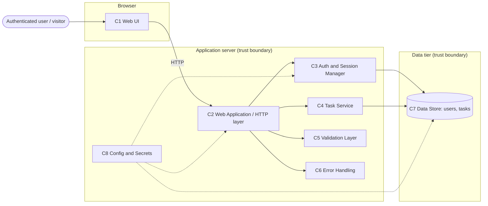
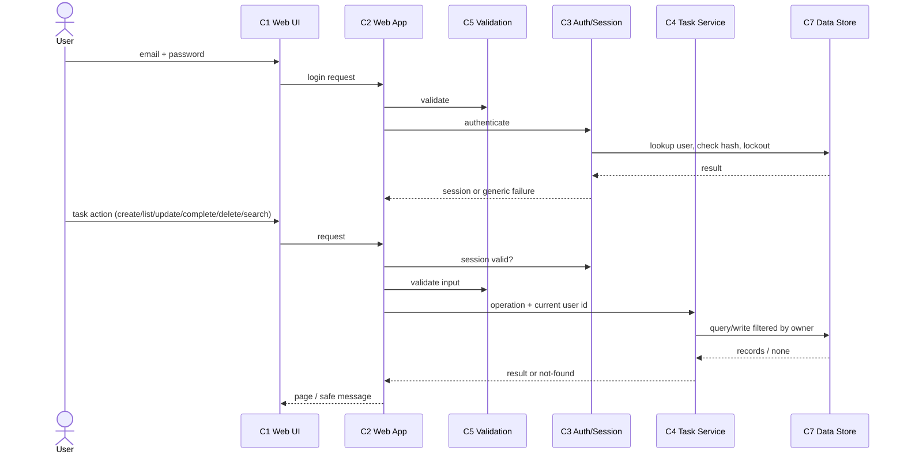

# Architecture: Online Task Management

**Status: APPROVED by the human ("architecture is approved", given directly to the main session; status updated there because the Architecture Agent had not confirmed a relayed approval).** The proposed stack, folder structure and session-cookie authentication are approved as drafted. Hosting target, lockout duration, HTTPS/CSRF confirmation, moving docs into `docs/`, and the Confluence waiver for this phase were not answered by the human and remain open items carried forward (section 11). Nothing is published to Confluence.
**Source:** `requirements.md` (APPROVED; defaults in its section 7).
**Confluence:** publishing waived/blocked. Not published. No Jira or Confluence items exist.

Legend: **Confirmed** = from approved requirements. **Proposed** = agent recommendation. **Assumption** = unconfirmed. **TBD** = needs human decision.

## 1. Architectural Drivers

| Driver | Source | Effect on architecture |
|--------|--------|------------------------|
| Security / per-user data isolation | NFR-1, FR-003.3, FR-004.3, FR-006.3, FR-007.3, OQ-9 | Every task operation is scoped to the authenticated user in one server-side place; foreign tasks return "not found". |
| Authentication and session | US-001, FR-001.4, OQ-2 | Server-side authentication gate on all task routes; 30 min inactivity timeout; lockout after 5 failed attempts. |
| Input validation | NFR-2, OQ-4, FR-002.3, FR-004.4 | Single server-side validation layer (title 1-100 trimmed, description max 1000). |
| No hard-coded secrets | NFR-3 | Secrets supplied via environment/local config, excluded from version control. |
| Safe error messages | NFR-4, FR-001.3 | Central error handling that returns generic messages. |
| Persistence | FR-002.2, FR-004.2, FR-005.2, OQ-10 | A durable data store for users and tasks, with created/updated timestamps. |
| Usability / compatibility | OQ-11, OQ-8 | Responsive web UI, evergreen desktop browsers, WCAG 2.1 AA where practical, interactive operations under 2 s, about 1000 tasks per user, no pagination. |

No availability, retention or scalability targets exist in the requirements; none are invented.

## 2. Components

| ID | Component | Responsibility | Requirements | Inputs | Outputs | Security notes |
|----|-----------|----------------|--------------|--------|---------|----------------|
| C1 | Web UI (browser client) | Login form, task list, empty state, create/edit forms, complete action, delete confirmation, search box, error display | FR-001.1, FR-001.3, FR-002.1, FR-003.1-4, FR-004.1, FR-005.1, FR-005.3, FR-006.1-2, FR-007.1-2, FR-007.4, OQ-6, OQ-11 | User input; server responses | HTTP requests to C2 | Escapes rendered user content; no secrets in client; client-side checks are convenience only. |
| C2 | Web Application / HTTP layer | Routing, request handling, rendering, serving UI | All FR | HTTP requests | HTTP responses | Only entry point; all task routes pass through C3. |
| C3 | Authentication and Session Manager | Verify credentials, enforce lockout and 30 min inactivity expiry, block unauthenticated access, identify the current user | FR-001.1-4, OQ-1, OQ-2 | Email, password | Authenticated session / current user identity; generic failure | Passwords compared against salted hashes only; generic failure message; session mechanism TBD. |
| C4 | Task Service | Create, list, update, complete (one-way), delete (hard), search (title, case-insensitive, partial); newest-first | FR-002 to FR-007, OQ-5, OQ-6, OQ-7, OQ-8 | Validated input + current user identity | Task data / not-found / validation result | Every query filtered by current user id; foreign id yields not found (OQ-9). |
| C5 | Validation Layer | Server-side validation of login and task input | NFR-2, FR-002.3, FR-004.4, OQ-4 | Raw input | Valid data or validation errors | Reject-by-default; trims title; rejects whitespace-only. |
| C6 | Error Handling | Map failures to clear, non-revealing messages | NFR-4, FR-001.3 | Exceptions/errors | Safe messages; details to server log only | No stack traces or internals in responses. |
| C7 | Data Store (users, tasks) | Persist users (hashed passwords, lockout state) and tasks (with created/updated timestamps) | FR-002.2, FR-004.2, FR-005.2, OQ-1, OQ-10 | Writes/queries from C3, C4 | Stored records | Hashes only, never plaintext; parameterised access via the data layer; access limited to the application. |
| C8 | Configuration and Secrets Provisioning | Supply secrets/settings from environment, not source; provision pre-provisioned accounts via a script | NFR-3, OQ-1 | Environment variables / local env file | Settings to C2, C3, C7 | Real env file git-ignored; sample file with placeholders only. |

Traceability: FR-001.x -> C1, C3, C5, C6; FR-002/004 -> C1, C4, C5, C7; FR-003/007 -> C1, C4, C7; FR-005 -> C4, C7; FR-006 -> C1, C4, C7; NFR-1 -> C3, C4; NFR-2 -> C5; NFR-3 -> C8; NFR-4 -> C6.

## 3. Component Interactions

| From | To | Purpose | Information | Mechanism |
|------|----|---------|-------------|-----------|
| C1 | C2 | User actions | Form data, requests | HTTP (browser to server); transport security (HTTPS) TBD |
| C2 | C3 | Authenticate / check session | Credentials, session identity | In-process call |
| C2 | C5 | Validate input | Raw input | In-process call |
| C2 | C4 | Task operations | Validated input + current user id | In-process call |
| C3 | C7 | Look up user, record failed attempts | Email, hash, lockout state | Data access layer |
| C4 | C7 | Read/write tasks | Task fields scoped by user id | Data access layer |
| C8 | C2/C3/C7 | Provide settings and secrets | Configuration values | Environment variables / local env file |
| C6 | C2 | Safe error responses | Generic messages | In-process |

## 4. External Dependencies

None required by the approved requirements. No external identity provider, API, email service or messaging system is needed (self-registration, password reset and sharing are out of scope). Status: Confirmed (none). Any hosting target is TBD (see Open Decisions).

## 5. Data Flow

1. User enters credentials in C1, which sends them to C2.
2. C2 validates (C5) and passes them to C3, which checks the stored salted hash in C7 and applies lockout rules. Success establishes a session; failure returns a generic error.
3. For each task action, C2 checks the session (C3), validates input (C5), then calls C4 with the current user identity.
4. C4 reads/writes tasks in C7 filtered by owner; results return through C2 to C1.
5. Errors pass through C6 so only safe messages reach the user.

Data stored: user accounts (email, password hash, lockout state) and tasks (title, description, completion status, owner, created/updated timestamps). No data leaves the system.

## 6. Diagrams

### Component diagram



### Data-flow diagram



## 7. Technology Choices (all approved; see sections 11-12, which supersede the "Proposed" labels below)

| Area | Proposed choice | Justification | Alternatives | Status |
|------|-----------------|---------------|--------------|--------|
| Language | Python 3 | Small CRUD app; readable; fits "simple web-based" scope | Node.js (TypeScript); C#/.NET | Proposed |
| Web framework | Flask (server-rendered templates) | Minimal, suits simple UI, form validation and responsive pages (OQ-11); single deployable | FastAPI + separate frontend; Express | Proposed |
| Data store | SQLite via SQLAlchemy | About 1000 tasks/user, no availability or scale target, zero external service (no external dependencies required) | PostgreSQL; MySQL | Proposed |
| Password hashing | argon2 or bcrypt (salted) | Requirement OQ-1 names both as examples | Either of the two | Proposed |
| Authentication/session | Server-side session with signed cookie (Flask-Login or equivalent), inactivity timeout 30 min | Meets FR-001.4, OQ-2; no external IdP required | Token-based (e.g. JWT) - not recommended without a need | Proposed; mechanism TBD until approved |
| Frontend | HTML templates, CSS, minimal JS (no SPA framework) | Meets responsive and accessibility goals simply | React/Vue SPA | Proposed |
| Test tooling | pytest (unit, integration), Flask test client | Python standard; covers acceptance criteria | unittest | Proposed |
| Hosting | TBD | No requirement given; local run assumed for development | Any | TBD |

## 8. Security Architecture

| Concern | Approach (high level) | Status |
|---------|----------------------|--------|
| Authentication | C3 verifies email/password against salted hashes; generic failure message; mechanism per section 7 | Proposed |
| Authorization / ownership | All C4 operations filtered by current user id; foreign tasks return not found (OQ-9) | Confirmed requirement, Proposed design |
| Brute force | Lockout after 5 failed attempts (temporary, duration TBD); 30 min inactivity expiry | Confirmed (OQ-2); lockout duration TBD |
| Input validation | Server-side in C5; output escaping in C1 to mitigate injection/XSS; parameterised data access | Proposed |
| Sensitive data | Passwords only as hashes; not logged; not shown in errors | Confirmed (OQ-1, NFR-4) |
| Secrets | Environment/local env file, git-ignored, sample with placeholders | Confirmed (NFR-3) |
| Transport | HTTPS in any non-local deployment; not specified in requirements | Assumption / TBD |
| CSRF protection | State-changing requests (create/update/complete/delete) should be protected against cross-site request forgery | Proposed |
| Error handling | Central C6; internals to server log only | Confirmed (NFR-4) |
| Audit logging | Not required; not included | Not in scope |

Least privilege: application uses only the data store it needs. Security controls above are design intent, not implemented.

## 9. Project Folder Structure (approved; sections 11-12 supersede this tree: no `docs/`, `scripts/run_dev.py` instead of `run_dev.sh`, plus `run.py`, `instance/`, `tests/conftest.py`)

Based on the project-folder-structure skill, Python (Flask) layout. Real paths are authoritative once approved.

```text
project-root/
├── app/                      # application package (source code)
│   ├── __init__.py           # app factory, loads configuration (C2, C8)
│   ├── routes/               # HTTP route handlers (C2)
│   │   ├── auth.py           # login routes (C2/C3)
│   │   └── tasks.py          # task routes (C2)
│   ├── services/             # business logic
│   │   ├── auth_service.py   # credentials, lockout, session rules (C3)
│   │   └── task_service.py   # task create/list/update/complete/delete/search (C4)
│   ├── validation.py         # input validation rules (C5)
│   ├── errors.py             # central error handling (C6)
│   ├── models.py             # data models and data access (C7)
│   ├── templates/            # HTML templates (C1)
│   └── static/               # CSS and minimal JS (C1)
├── tests/                    # mirrors app/
│   ├── routes/               # tests for app/routes
│   ├── services/             # tests for app/services
│   ├── test_validation.py    # tests for app/validation.py
│   ├── test_errors.py        # tests for app/errors.py
│   └── test_models.py        # tests for app/models.py
├── scripts/
│   ├── provision_users.py    # create pre-provisioned accounts, no hard-coded credentials (C8, OQ-1)
│   └── run_dev.sh            # local run helper
├── docs/                     # requirements.md, architecture.md, design review, reports
├── requirements.txt          # Python dependencies
├── pytest.ini                # test configuration
├── .env.example              # placeholder settings only
├── .gitignore                # excludes .env, local database, venv, caches, build output
└── README.md                 # setup and run instructions
```

Note: `requirements.md` and `architecture.md` currently sit at the repository root; moving them into `docs/` is TBD (see Open Decisions).
Secrets and local configuration: the real `.env` and the local SQLite database file are git-ignored and are not part of the tree. Build output, virtual environments and caches are likewise git-ignored.

## 10. Assumptions

- A1: Single application server and single data store; no distributed deployment (no scale target exists).
- A2: HTTPS used outside local development.
- A3: Pre-provisioned accounts are created by an operator script, not through the UI.

## 11. Decisions (resolved after Design Review)

Resolved by the human ("approved use defaults", given directly to the main session; edits applied in the main session because the Architecture Agent could not verify a relayed approval). Design Review findings F-01 to F-13 are addressed by the amendments in section 12.

1. Technology stack: APPROVED (Python 3 + Flask, SQLite + SQLAlchemy, argon2, server-side session cookie, server-rendered HTML, pytest).
2. Project folder structure: APPROVED, with the amendments in section 12.
3. Authentication/session: APPROVED, server-side signed session cookie.
4. Hosting: RESOLVED, local machine only. No remote URLs, repositories or deployments.
5. Lockout duration: RESOLVED (default), 15 minutes, auto-expiring.
6. HTTPS: moot for local-only running (required if ever deployed beyond local). CSRF protection: MANDATORY (default).
7. Docs location: RESOLVED (default), `requirements.md`, `architecture.md`, `design-review.md` stay at the repository root; the `docs/` entry in section 9 is not used.
8. Confluence: waived for all phases. Nothing is published.

## 12. Amendments from Design Review

- A-01 (F-01) Status labels in sections 7 and 8 are superseded by section 11: stack, folder structure and session-cookie authentication are Approved; hosting is local only.
- A-02 (F-02) CSRF protection is mandatory for all state-changing requests; mechanism: Flask-WTF CSRF tokens (or equivalent).
- A-03 (F-03) Session cookie attributes: HttpOnly, SameSite=Lax, Secure when served over HTTPS. The session signing key (SECRET_KEY) is a secret supplied via environment under C8 and listed in `.env.example` as a placeholder.
- A-04 (F-04) Lockout is time-based: 5 consecutive failures lock the account for 15 minutes, auto-expiring; the counter resets on successful login. Locked-account and invalid-credential responses use the same generic message.
- A-05 (F-05) Unknown email and wrong password return the same generic message with comparable timing (dummy hash check for unknown emails).
- A-06 (F-06) Password hashing: argon2 (argon2-cffi). Session handling: Flask-Login with signed cookie; inactivity timeout of 30 minutes is sliding, refreshed on each authenticated request.
- A-07 (F-07) The 8-character password minimum is enforced in `scripts/provision_users.py`. Search escapes LIKE wildcards and matches case-insensitively (lower-cased comparison to cover non-ASCII). Minimal data model: `users(id, email unique, password_hash, failed_attempts, locked_until)` and `tasks(id, owner_id FK, title, description, completed, created_at, updated_at)` with indexes on `tasks.owner_id` and `(owner_id, title)`. Detailed schema is left to implementation planning.
- A-08 (F-08) C1 is rendered server-side (templates in `app/templates`) and executed in the browser. The sequence diagram additionally covers: unauthenticated request redirects to login (FR-001.4); errors pass through C6 and return a generic message.
- A-09 (F-09) Traceability additions: NFR-1 -> C3, C4, C7 and transport/cookie settings; OQ-11 -> C1 (responsive, accessible templates) and C7 (indexes); OQ-3 -> out of scope, no component.
- A-10 (F-10) Folder structure additions: entry point `run.py`; SQLite file under `instance/` (git-ignored); `tests/conftest.py`; run helper `scripts/run_dev.py` (cross-platform) replacing `run_dev.sh`.
- A-11 (F-11) `.claude/`, `inputs/` and `skills/` are workflow files, not part of the application tree; they are not part of the product. Nothing is committed in this workflow (local only).
- A-12 (F-12) Logout remains out of scope; residual risk accepted by the human's defaults.
- A-13 (F-13) Server logs must never include passwords, session tokens or CSRF tokens. Audit logging remains out of scope.
